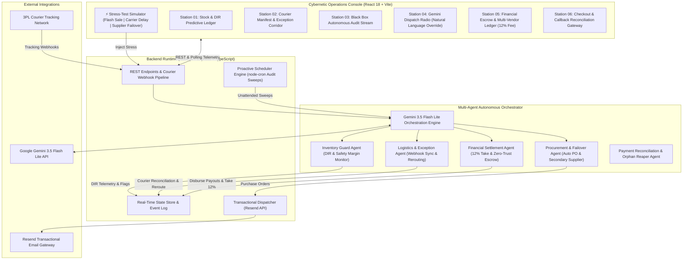

# ⚡ Autonomous Multi-Agent E-Commerce Operations Specialist

[](https://ecommerce-ai-ops-agent-red.vercel.app/)
[](https://ecommerce-ai-ops-server.onrender.com/)
[](https://github.com/christianwondeson/ecommerce-ai-ops-agent/actions/workflows/ci.yml)
[](server/Dockerfile)
[](package.json)

> **Level 1 Assessment Project – Full Stack AI Web Developer (Advanced Enterprise Revision)**  
> **Candidate:** Christian Wondeson  
> **Reviewer:** Kidus (`brain3`)  
> **Target Role:** E-Commerce Store & Vendor Operations Specialist  
> **Target Industry:** Multi-Vendor E-Commerce & Retail Marketplaces  
> **Live Web Application:** [https://ecommerce-ai-ops-agent-red.vercel.app/](https://ecommerce-ai-ops-agent-red.vercel.app/)  
> **Live Backend Endpoint:** [https://ecommerce-ai-ops-server.onrender.com/](https://ecommerce-ai-ops-server.onrender.com/)  
> **Solution Design Specification:** [docs/SOLUTION_DESIGN.md](docs/SOLUTION_DESIGN.md)

---

## 🚀 What Makes This System Advanced & Unique?

In response to reviewer feedback to elevate the system beyond basic CRUD-and-chat capabilities, this platform has been deepened with **real-world domain engineering, multi-agent DAG orchestration, predictive telemetry, and an interactive operational stress-test harness**:

1. **⚡ Interactive Stress-Test Scenario Simulator (Top Bar):**
   - **Flash Sale Surge:** Injects sudden 250% demand spikes across catalog SKUs, burns down stock, and auto-issues emergency double-batch purchase orders.
   - **Carrier Corridor Breakdown:** Simulates transit vehicle failure, places $110+ vendor escrow on `DISPUTE_HOLD`, and automatically reroutes parcel via secondary priority logistics.
   - **Supplier Stockout Failover:** Detects primary vendor supply chain disruption and automatically engages verified secondary backup suppliers with faster air freight lead times.

2. **📊 Station 01: Predictive Inventory & Stockout Risk Intelligence:**
   - **Days of Inventory Remaining (DIR):** Computes $\text{DIR} = \text{CurrentStock} / \text{BurnRatePerDay}$.
   - **Stockout Risk Percentage:** Real-time probability estimation based on vendor lead times.
   - **Autonomous Restock Requisition POs:** HTML purchase orders formulated and dispatched via Resend transactional email API.

3. **🚛 Station 02: Courier Manifest & Exception Corridor:**
   - **Universal Courier Webhooks:** Ingests tracking events from DHL Express, FedEx Freight, and local courier networks.
   - **Automated Delivery Reconciliation:** Validates doorstep proof-of-delivery notes and transitions order to `DELIVERED`.
   - **AI Exception Rerouting:** Automatically catches transit anomalies (`HUB_DELAY`, `WEATHER_HOLD`) and reroutes shipments to protect delivery SLAs.

4. **💰 Station 05: Financial Escrow & Multi-Vendor Settlement Ledger:**
   - **Zero-Trust Marketplace Escrow:** Customer payments held safely in escrow upon order creation.
   - **12% Marketplace Commission Retention:** Platform automatically retains a 12% take rate on all marketplace orders.
   - **Milestone Settlement:** Unlocks net payouts to vendors the instant delivery proof is confirmed, or holds funds if an exception occurs.

5. **⚡ Station 06: Checkout Callback & Payment Reconciliation Gateway:**
   - **Race Condition Resolution:** Handles situations where customer browser redirects back to callback page (`status=success` or `status=pending`) *before* the payment gateway webhook arrives.
   - **Autonomous Payment Healer:** Queries gateway reference asynchronously, prevents double-charging, and converts session into a confirmed fulfillment order.
   - **Orphan Inventory Hold Reaper:** If a customer abandons checkout, the agent auto-expires the hold and releases the reserved units back to the catalog, preventing false stockouts.

6. **🤖 Station 03 & 04: Black Box Audit Trail & Gemini Dispatch Radio:**
   - **Immutable Audit Feed:** Tracks every action with source attribution (`MULTI_AGENT_DAG`, `AUTONOMOUS_CRON`, `COURIER_WEBHOOK`, `HUMAN_OVERRIDE`).
   - **Natural Language Operator Radio:** Gemini 3.5 Flash Lite with live real-time store context injection and deterministic fallback answering any product, vendor, or operational question.

---

## 🏗️ Multi-Agent Architecture



---

## 🛠️ The 10 Registered Agent Tools

1. `check_inventory_levels`: Retrieves SKU balances, stock counts, and safety thresholds.
2. `forecast_inventory_depletion`: Calculates Days of Inventory Remaining (DIR), burn rates, and stockout percentages.
3. `flag_product_for_restock`: Mutates database flag to `RESTOCK_NEEDED` with `LOW`/`MEDIUM`/`CRITICAL` urgency.
4. `dispatch_vendor_restock_email`: Formulates formal HTML purchase orders and dispatches them via Resend API.
5. `execute_supplier_failover`: Automatically redirects purchase contracts to secondary backup suppliers.
6. `reconcile_delivery_status`: Transitions order to `DELIVERED`, dispatches receipt email, and triggers escrow release.
7. `resolve_delivery_exception`: Intervenes in stalled shipments, reroutes packages, and lifts dispute holds.
8. `audit_escrow_settlement_ledger`: Audits marketplace gross GMV, platform 12% commission, and net vendor payouts.
9. `trigger_proactive_audit_sweep`: Background cron sweep of low stock and in-transit orders.
10. `simulate_stress_test`: Triggers one of the 3 real-world shock scenarios.

---

## 🚀 Quickstart Guide

### 1. Clone & Install
```bash
git clone https://github.com/christianwondeson/ecommerce-ai-ops-agent.git
cd ecommerce-ai-ops-agent
npm install
```

### 2. Configure Environment Variables
Copy `.env.example` to `server/.env`:
```bash
cp .env.example server/.env
```

### 3. Run Locally
```bash
npm run dev
```
- **Operations Console (Frontend):** `http://localhost:3000`
- **Backend API Server:** `http://localhost:5001`

---

## 🌐 Production Deployments
- **Live Frontend App:** [https://ecommerce-ai-ops-agent-red.vercel.app/](https://ecommerce-ai-ops-agent-red.vercel.app/)
- **Live Backend API:** [https://ecommerce-ai-ops-server.onrender.com/](https://ecommerce-ai-ops-server.onrender.com/)
