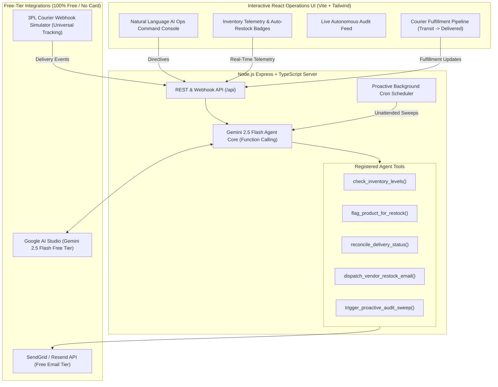

# ⚡ Autonomous E-Commerce Operations & Fulfillment Specialist

[](https://github.com/christianwondeson/ecommerce-ai-ops-agent/actions/workflows/ci.yml)
[](https://vercel.com)
[](server/Dockerfile)
[](package.json)

> **Level 1 Assessment Project – Full Stack AI Web Developer**  
> **Target Role:** E-Commerce Store & Vendor Operations Specialist  
> **Target Industry:** Multi-Vendor E-Commerce & Retail Marketplaces  
> **Reviewer:** Kidus (`kidus@brain3.ai`)  
> **Solution Design Specification:** [docs/SOLUTION_DESIGN.md](docs/SOLUTION_DESIGN.md) | [Download PDF](docs/Solution_Design_Specification_AI_Ops_Specialist.pdf)

---

## 📹 Video Walkthrough
- **Loom / Video Link:** `[INSERT_YOUR_VIDEO_RECORDING_LINK_HERE]`
- **Duration:** ~4 minutes
- **Agenda:** Problem breakdown $\rightarrow$ Architecture $\rightarrow$ Live UI Demonstration $\rightarrow$ Code walkthrough (Frontend & Backend).

---

## 🎯 The Real-World Problem Solved

In high-volume e-commerce and multi-vendor marketplaces, operations teams spend 65%+ of their daily bandwidth on repetitive manual dashboard data entry:

1. **Manual Inventory Restock Flagging:** Store operators manually inspect stock balances. When a product runs out or dips below minimum safety thresholds, someone must manually flag the item as "RESTOCK NEEDED" on the merchant dashboard and manually draft emails to suppliers. Inevitably, manual delays cause stockouts, unfulfillable orders, and lost sales.
2. **Manual Delivery Status Reconciliation:** When third-party couriers (local dispatch riders, DHL, FedEx) complete deliveries, the e-commerce dashboard remains stuck in `IN_TRANSIT` until an operations associate manually cross-references courier dispatch reports and clicks "Mark as Delivered." This manual friction delays merchant escrow payouts, distorts customer return windows, and inflates customer service inquiries.

**The Solution:** An Autonomous AI Operations Specialist that operates 24/7 to:
- Continuously monitor stock levels, automatically set restock flags on the merchant dashboard, and autonomously draft/dispatch restock orders to suppliers.
- Reconcile courier tracking events with platform orders in real-time, autonomously transitioning orders to `DELIVERED`.
- Run proactive scheduled audits to catch delayed shipments and send executive health digests to store leadership.

---

## 🏗️ High-Level System Architecture



---

## 🛠️ The 5 Concrete Agent Tools (Function Calling)

1. `check_inventory_levels(filter)`: Scans all SKU balances and flags items below safety thresholds.
2. `flag_product_for_restock(productId, urgency, reason)`: Mutates database flag to `RESTOCK_NEEDED` with priority rating (`LOW`, `MEDIUM`, `CRITICAL`).
3. `reconcile_delivery_status(orderId, deliveryNotes)`: Analyzes courier delivery proof and mutates order status to `DELIVERED`, recording timestamp and releasing escrow.
4. `dispatch_vendor_restock_email(productId, quantity, instructions)`: Formulates structured purchase orders and sends them via transactional email.
5. `trigger_proactive_audit_sweep()`: Manually triggers the background cron auditor to scan all inventory thresholds and in-transit delivery statuses immediately.

---

## ⏰ Proactive Action Engine (Background Scheduler)

The agent does not simply wait for user prompts:
- Driven by a background cron scheduler (`node-cron`).
- Executes periodic unattended sweeps:
  - Automatically identifies products where sales depleted stock $\le \text{threshold}$ and flags them for restock.
  - Automatically reconciles packages marked as delivered by carriers.
  - Detects shipments stuck in transit for $>24\text{ hours}$.
  - Logs structured audit summaries to the real-time event feed.

---

## 🚀 Quickstart Guide

### 1. Prerequisites
- Node.js `v18+` or `v20+` (tested on `v22.20.0`)
- npm `v9+` or `v10+`

### 2. Clone & Install
```bash
cd ecommerce-ai-ops-agent
npm install
```

### 3. Configure Environment Variables
Copy `.env.example` to `server/.env`:
```bash
cp .env.example server/.env
```
*(Optional)* Add your free Gemini API key from [Google AI Studio](https://aistudio.google.com):
```env
GEMINI_API_KEY=AIzaSy...
```
> **Note:** The application features an intelligent built-in fallback mode, so evaluators can run and test all tools, reconciliations, and restock actions immediately even before inserting an API key!

### 4. Run Both Server & Client Concurrently
```bash
npm run dev
```

- **Operations Dashboard (Frontend):** `http://localhost:3000`
- **Backend API Server:** `http://localhost:5001`
- **Health Check Endpoint:** `http://localhost:5001/health`

---

## 🎬 Live Demo Walkthrough Guide (For Video)

1. **Demonstrate Autonomous Stockout Guard:**
   - In the **Inventory Guard** table, find a product with healthy stock (e.g., `ErgoDynamic Office Chair`).
   - Click **"Sell 1"** repeatedly until stock drops below the threshold.
   - Watch the agent **automatically flag the product as `RESTOCK NEEDED`** in real-time, generate an audit log entry, and prepare a purchase order.
   - Click **"Dispatch PO"** to send the supplier email via API.
2. **Demonstrate Courier Delivery Reconciliation:**
   - In the **Fulfillment Pipeline** table, find an order in `IN TRANSIT` (e.g., `ORD-2026-1001`).
   - Click **"Simulate Delivery"** (simulates incoming 3PL carrier webhook).
   - Observe the agent validate the proof note and mutate the order status to **`DELIVERED`**, update the timestamp, and record `AI Reconciled`.
3. **Demonstrate Proactive Scheduler:**
   - Click **"Run Proactive Audit"** in the top navigation bar.
   - Watch the agent conduct an unattended sweep, identify delayed shipments, and output findings.
4. **Demonstrate Natural Language AI Console:**
   - Switch to the **AI Command Console & Audit Log** tab.
   - Click one of the suggested directives (e.g. *"Audit stock and flag critical low-inventory items"*).
   - Show Gemini 2.5 Flash reasoning through the prompt and executing the tools.

---

## 🌐 Production Deployment Guide

### Option 1: Frontend on Vercel
1. Import repository into [Vercel](https://vercel.com/new).
2. Set **Root Directory** to `client` (or leave at root, uses `vercel.json`).
3. Set Environment Variable:
   - `VITE_API_BASE_URL`: URL of your deployed backend (e.g. `https://ecommerce-ai-ops-server.onrender.com`).
4. Click **Deploy**.

### Option 2: Backend on Render.com (Free Tier)
1. In [Render Dashboard](https://dashboard.render.com), click **New +** $\rightarrow$ **Blueprint**.
2. Connect your GitHub repository: `https://github.com/christianwondeson/ecommerce-ai-ops-agent`.
3. Render will auto-detect `render.yaml`. Add your `GEMINI_API_KEY` and `RESEND_API_KEY` in the environment settings and click **Apply**.

### Option 3: Docker / GCP Cloud Run (Always Free Tier)
Deploy the container directly using the included multi-stage Dockerfile:
```bash
docker build -t ecommerce-ai-ops-server -f server/Dockerfile server/
docker run -p 5001:5001 --env-file server/.env ecommerce-ai-ops-server
```

---

## 📄 Solution Design Specification
The complete formal SRS specification submitted for Level 1 review is available in:
- Markdown: [`docs/SOLUTION_DESIGN.md`](docs/SOLUTION_DESIGN.md)
- Printable PDF: [`docs/Solution_Design_Specification_AI_Ops_Specialist.pdf`](docs/Solution_Design_Specification_AI_Ops_Specialist.pdf)
