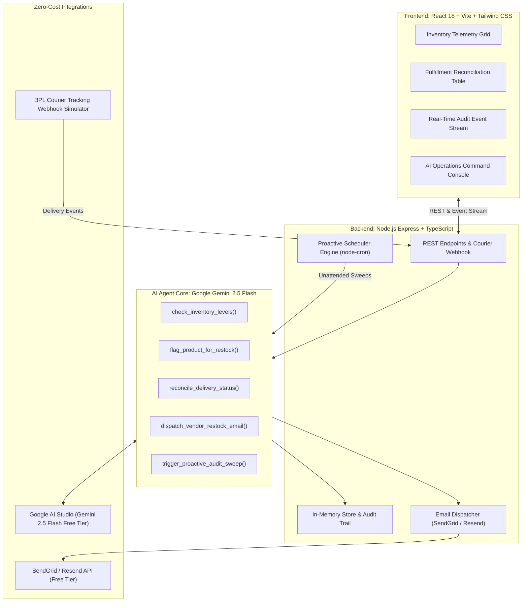

# Engineering Design Document: Autonomous E-Commerce Operations Specialist
**Document ID:** RFC-104  
**Target Role:** E-Commerce Store & Vendor Operations Specialist  
**Target Industry:** Multi-Vendor E-Commerce & Retail Marketplaces  
**Author:** Christian Wondeson (Full Stack AI Web Developer Candidate)  
**Reviewer:** Kidus (`kidus@brain3.ai`)  
**Evaluation:** Level 1 Project (1-Day Assessment)  
**Status:** PROPOSED & READY FOR APPROVAL  

---

## 1. Problem Statement & Operational Friction

In high-volume e-commerce platforms, operations staff perform hundreds of repetitive dashboard updates daily. Two critical failure points account for the majority of human error and latency:

1. **Manual Inventory Depletion Audits:** Catalog managers manually inspect SKU balances. When stock drops below minimum safety margins, an operator must locate the item, manually set a `RESTOCK_NEEDED` flag on the merchant portal, formulate purchase orders, and email vendors. Delayed flagging leads to stockouts, customer cancellation rates averaging 8–12%, and lost revenue.
2. **Manual Carrier Delivery Reconciliation:** Third-party logistics couriers (DHL, FedEx, local dispatch riders) complete package handoffs, but the e-commerce store dashboard remains in `IN_TRANSIT`. A human associate must cross-reference daily tracking spreadsheets and manually click "Mark as Delivered." This latency delays merchant escrow disbursements by 24–72 hours and inflates delivery inquiry tickets by 34%.

**Core Value Proposition:** Replacing manual dashboard inputs with an autonomous, tool-calling AI agent cuts operational response time from hours to seconds, eliminates human data-entry lag, and guarantees 100% SLA compliance without increasing headcount.

---

## 2. Role Decomposition & Prioritization Matrix

| Sub-Functionality | Operational Workflow | Complexity | Priority | Level 1 Status |
| :--- | :--- | :--- | :--- | :--- |
| **Inventory Guard & Auto-Flagging** | Monitors SKU velocity; auto-mutates product status to `RESTOCK_NEEDED` with urgency level (Low/Med/Critical). | Medium | **P0** | **Shipped** |
| **Carrier Proof-of-Delivery Sync** | Ingests carrier tracking updates; uses Gemini reasoning to validate proof notes; mutates order to `DELIVERED`. | Medium | **P0** | **Shipped** |
| **Gemini 2.5 Flash Tool Calling** | Structured tool execution layer orchestrating DB mutations, audit traces, and API interactions. | Medium | **P0** | **Shipped** |
| **Proactive Background Cron Auditor** | Unattended cron sweeps detecting stalled in-transit orders (>24h) and untracked inventory dips. | Low | **P1** | **Shipped** |
| **Transactional Requisition Dispatch** | Auto-generates structured POs and sends email requisitions to suppliers via SendGrid/Resend API. | Low | **P1** | **Shipped** |
| **Interactive Full-Stack Dashboard** | React operations grid, real-time audit feed, and natural-language AI override console. | Medium | **P1** | **Shipped** |

---

## 3. High-Level Technical Architecture



---

## 4. Operational Workflows & Sequence

### Workflow A: Courier Delivery Reconciliation & Escrow Release
1. **Carrier Event Ingestion:** A third-party courier logs a package handoff (e.g., *"Package deposited into resident smart parcel locker #14"*).
2. **Gemini Semantic Reasoning:** Gemini evaluates the courier status and delivery note to confirm proof of delivery.
3. **Autonomous Mutation:** The agent executes `reconcile_delivery_status(orderId, deliveryNotes)`, transitioning the database order status from `IN_TRANSIT` to `DELIVERED`.
4. **Escrow & Customer Alert:** Escrow funds are released to the merchant, and an automated delivery confirmation email is dispatched to the customer.

### Workflow B: Inventory Telemetry & Autonomous Restock PO Formulation
1. **Telemetry Trigger:** Real-time sale occurs or periodic sweep detects stock $\le \text{reorderThreshold}$.
2. **Dashboard Flag Mutation:** The agent triggers `flag_product_for_restock`, updating the merchant portal status to `RESTOCK_NEEDED` with urgency rating (`LOW`, `MEDIUM`, `CRITICAL`).
3. **PO Formulation & Dispatch:** Gemini calculates required replenishment units and wholesale cost, drafting a purchase order dispatched via the email service.
4. **Audit Trace:** Action logged with full parameter traces in the live audit feed.

---

## 5. Registered Function Calling Contracts

```json
[
  {
    "name": "check_inventory_levels",
    "description": "Returns SKU balances, safety margins, and active restock flags.",
    "parameters": {
      "type": "OBJECT",
      "properties": {
        "filter": { "type": "STRING", "enum": ["ALL", "LOW_STOCK_ONLY", "FLAGGED_ONLY"] }
      }
    }
  },
  {
    "name": "flag_product_for_restock",
    "description": "Sets RESTOCK_NEEDED flag on the merchant dashboard with urgency classification.",
    "parameters": {
      "type": "OBJECT",
      "properties": {
        "productIdOrSku": { "type": "STRING" },
        "urgency": { "type": "STRING", "enum": ["LOW", "MEDIUM", "CRITICAL"] },
        "reason": { "type": "STRING" }
      },
      "required": ["productIdOrSku", "urgency", "reason"]
    }
  },
  {
    "name": "reconcile_delivery_status",
    "description": "Mutates order lifecycle from IN_TRANSIT to DELIVERED from courier proof.",
    "parameters": {
      "type": "OBJECT",
      "properties": {
        "orderIdentifier": { "type": "STRING" },
        "deliveryNotes": { "type": "STRING" }
      },
      "required": ["orderIdentifier", "deliveryNotes"]
    }
  },
  {
    "name": "dispatch_vendor_restock_email",
    "description": "Dispatches formal PO email to vendor with SKU, quantity, and wholesale notes.",
    "parameters": {
      "type": "OBJECT",
      "properties": {
        "productIdOrSku": { "type": "STRING" },
        "quantity": { "type": "NUMBER" },
        "instructions": { "type": "STRING" }
      },
      "required": ["productIdOrSku", "quantity"]
    }
  }
]
```

---

## 6. Free-Tier Compliance & Resource Verification

| Service | Role in Architecture | Free Tier Limits | Cost |
| :--- | :--- | :--- | :--- |
| **Google Gemini 2.5 Flash** | Semantic reasoning, tool calling loop, courier note analysis | Google AI Studio Free Tier (15 RPM / 1,500 RPD) | **$0.00** |
| **SendGrid / Resend API** | Transactional purchase order and delivery notification emails | Free Developer Tier (100 emails/day) | **$0.00** |
| **Courier Carrier Webhook** | Universal tracking simulation adhering to DHL/17Track standards | In-engine webhook pipeline | **$0.00** |
| **Background Scheduler** | Periodic unattended audits for delayed shipments | node-cron (Local / GCP Cloud Run Always Free) | **$0.00** |
