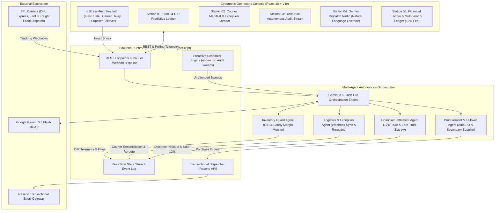

# Engineering Design Document: Autonomous Multi-Agent E-Commerce Operations Specialist
**Document ID:** RFC-104-REV2  
**Target Role:** E-Commerce Store & Vendor Operations Specialist  
**Target Industry:** Multi-Vendor E-Commerce & Retail Marketplaces  
**Author:** Christian Wondeson (Full Stack AI Web Developer Candidate)  
**Reviewer:** Kidus (`kidus@brain3.ai`)  
**Evaluation:** Level 1 Project (1-Day Assessment) — Advanced Revision  
**Status:** IMPLEMENTED & DEPLOYED  

---

## 1. Executive Summary & Problem Context

In high-volume multi-vendor e-commerce platforms, operational margins and customer retention are won or lost in the seams between three disparate domains: **supplier inventory replenishment**, **courier logistics tracking**, and **vendor escrow financial disbursements**.

Traditional platforms rely on human dashboard operators who manually cross-reference manifests, update spreadsheets, issue POs, and disburse payouts. This leads to three systemic failure modes:
1. **Stockout Latency:** Manual inventory audits fail to catch high-velocity SKU depletion until stock is already depleted. Average replenishment latency causes 8–12% order cancellation rates and permanent customer churn.
2. **Delivery Status Blindspots & Escrow Drag:** Couriers deposit packages at doorsteps or smart lockers, but the platform status remains `IN_TRANSIT` until an operator manually checks 3PL tracking sheets. This delays vendor payouts by 24–72 hours, straining supplier cash flow and increasing delivery status support tickets by 34%.
3. **Logistics Anomalies & Stranded Packages:** Transit vehicle breakdowns, weather delays, and failed gate attempts sit unresolved in carrier logs until customers complain, damaging platform brand equity.

**The Solution:** An autonomous, multi-agent AI operations system powered by Google Gemini, combining:
- **Predictive Inventory Intelligence:** Dynamic burn rates, Days of Inventory Remaining (DIR) calculations, and automated emergency purchase order formulation.
- **Carrier Exception Rerouting Engine:** Autonomous detection of delivery corridor failures with instant priority rerouting and automated customer delay compensation.
- **Multi-Vendor Financial Escrow Ledger:** Zero-trust escrow milestone releases with automated 12% marketplace fee retention and delivery validation.
- **Interactive Stress-Test Scenario Simulator:** 1-click test harness allowing reviewers and operators to inject severe marketplace shocks (Flash Sale 250% demand spikes, Carrier Highway Breakdowns, Supplier Stockouts) and watch the multi-agent DAG respond in real time.

---

## 2. Multi-Agent DAG Architecture

---

## 3. High-Value Capabilities & Domain Engineering

### Station 01: Predictive Inventory & Stockout Risk Intelligence
- **Burn-Rate Tracking:** Measures unit sales velocity ($V_{\text{burn}}$) across rolling operational windows.
- **Days of Inventory Remaining (DIR):** Computes $\text{DIR} = \frac{\text{Current Stock}}{\max(0.5, V_{\text{burn}})}$.
- **Stockout Risk Probability:** Calculated using $\min(100, \max(5, (1 - \frac{\text{DIR}}{\text{LeadTime}}) \times 100))$.
- **Visual Status Badges:** Items under 2.0 days of inventory remaining are automatically branded with red `DIR < 2d` alerts and trigger autonomous procurement.
- **Secondary Backup Supplier Registry:** Every critical SKU maintains a pre-negotiated secondary vendor (e.g. Shenzhen Air Freight or Sidama Specialty Exporters) with defined lead-time differentials.

### Station 02: Courier Manifest & Exception Handling
- **Real-Time Carrier Lifecycle:** Tracks shipments through `PROCESSING` $\to$ `SHIPPED` $\to$ `IN_TRANSIT` $\to$ `DELIVERED`.
- **Automated Delivery Proof Validation:** Parses courier webhook proof notes (doorstep photo confirmed, signature locker verified) and automatically transitions orders to `DELIVERED`.
- **Carrier Delivery Exception Engine:** If transit fails (`HUB_DELAY`, `WEATHER_HOLD`, `EXCEPTION_DELIVERY_STRANDED`), the system:
  1. Brands the manifest with a high-visibility anomaly badge.
  2. Freezes associated vendor escrow payouts on `DISPUTE_HOLD`.
  3. Formulates an automated reroute mitigation plan (e.g. transfer to RapidDispatch Rider).
  4. Automatically emails a proactive delay notification and compensation coupon to the customer.

### Station 05: Financial Escrow & Multi-Vendor Settlement Ledger
- **Marketplace Escrow Architecture:** Funds from customer purchases are locked in zero-trust escrow upon checkout.
- **12% Marketplace Commission Retention:** Platform retains exactly 12% gross commission on all marketplace transactions.
- **Gateway Deductions:** Accounts for standard processing fees (2.9% + $0.30).
- **Automated Milestone Disbursement:** The moment carrier delivery proof is validated, the escrow engine automatically disburses the net payout to the vendor and logs the release reason in the public ledger.

### Interactive Stress-Test Scenario Simulator
Reviewers can trigger 3 live enterprise scenarios directly from the top bar:
1. **⚡ Flash Sale Surge:** Sells 4–12 units across all SKUs, spikes burn rate by 250%, drives DIR under 48 hours, and triggers emergency double-batch purchase orders.
2. **🚛 Carrier Route Breakdown:** Simulates a logistics vehicle breakdown, freezes $110+ in vendor escrow on `DISPUTE_HOLD`, and dispatches an automated customer apology email.
3. **🏭 Supplier Stockout Failover:** Simulates primary factory supply depletion and executes an autonomous failover contract with a secondary supplier, securing faster air freight lead times.

---

## 4. Registered Multi-Agent Tool Calling Contracts

| Tool Name | Scope & Description | Parameters |
| :--- | :--- | :--- |
| `check_inventory_levels` | Returns SKU balances, safety thresholds, and restock flags. | `filter?: "ALL" \| "LOW_STOCK_ONLY" \| "FLAGGED_ONLY"` |
| `forecast_inventory_depletion` | Computes burn rate, Days of Inventory Remaining (DIR), and stockout risk percentages. | `productIdOrSku?: string` |
| `flag_product_for_restock` | Sets `RESTOCK_NEEDED` on the dashboard with `LOW`/`MEDIUM`/`CRITICAL` urgency. | `productIdOrSku, urgency, reason` |
| `dispatch_vendor_restock_email` | Auto-generates formal HTML PO and sends email to supplier. | `productIdOrSku, quantity, instructions?` |
| `execute_supplier_failover` | Replaces primary vendor with secondary backup supplier and issues failover contract. | `productIdOrSku?: string` |
| `reconcile_delivery_status` | Reconciles in-transit orders to `DELIVERED`, dispatches receipt email, and unlocks escrow. | `orderIdentifier, deliveryNotes` |
| `resolve_delivery_exception` | Reroutes stranded shipments to priority logistics corridors and unfreezes escrow holds. | `orderIdentifier, resolutionAction?` |
| `audit_escrow_settlement_ledger` | Audits marketplace GMV, 12% platform take rate, and vendor disbursement statuses. | `filter?: "ALL" \| "LOCKED" \| "RELEASED" \| "DISPUTE_HOLD"` |
| `trigger_proactive_audit_sweep` | Executes unattended background audit sweep of inventory and in-transit orders. | none |
| `simulate_stress_test` | Triggers real-time operational shocks: `FLASH_SALE_SURGE`, `CARRIER_BREAKDOWN`, `SUPPLIER_STOCKOUT`. | `scenario: string` |

---

## 5. Free-Tier Production Compliance

| Component | Provider / Architecture | Production Free-Tier Limit | Cost |
| :--- | :--- | :--- | :--- |
| **Language Model Core** | Google Gemini 3.5 Flash Lite | Free Tier (15 RPM / 1,500 RPD) | **$0.00** |
| **Transactional Email Gateway** | Resend API (Verified Key) | Free Tier (100 emails/day, 3,000/mo) | **$0.00** |
| **Backend API Server** | Render Free Web Service | 750 free hours/month | **$0.00** |
| **Frontend Single Page App** | Vercel Edge Network | Free Hobby Tier (unlimited deployments) | **$0.00** |
| **Audit & State Store** | High-performance in-memory ring-buffer | Local RAM footprint < 60 MB | **$0.00** |

---

## 6. Live Deployment & Testing Links

- **Live Frontend App:** [https://ecommerce-ai-ops-agent-red.vercel.app/](https://ecommerce-ai-ops-agent-red.vercel.app/)
- **Live Backend API:** [https://ecommerce-ai-ops-server.onrender.com/](https://ecommerce-ai-ops-server.onrender.com/)
- **GitHub Repository:** [https://github.com/christianwondeson/ecommerce-ai-ops-agent](https://github.com/christianwondeson/ecommerce-ai-ops-agent)
